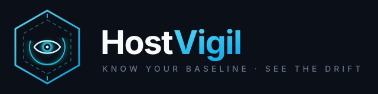

<p align="center"></p>
<p align="center">
  <a href="https://github.com/iamjammie/HostVigil/actions/workflows/validate.yml"></a>
  
  
  
  
</p>

<!-- suite-nav:start -->
> **Part of the [iamjammie Hunt suite](https://iamjammie.github.io/FluxHunt/suite.html)** — open-source, offline-first security tooling and knowledge.
>
> 🧠 [Hunt-Sage](https://github.com/iamjammie/hunt-sage) (knowledge) · 🌊 [FluxHunt](https://github.com/iamjammie/FluxHunt) (wire) · 🖥️ [HostHunt](https://github.com/iamjammie/HostHunt) (box) · 📡 **HostVigil** (fleet) · 🔐 [ADHuntX](https://github.com/iamjammie/ADHuntX) (directory) · 🎯 [Sentinel Matrix](https://github.com/iamjammie/Sentinel-Matrix) (detection coverage) · 🧬 [TTP NEXUS](https://github.com/iamjammie/TTP-Nexus) (frameworks) · 🛡️ [ThreatIntFlux](https://github.com/iamjammie/ThreatIntFlux) (threat intel) · 🔦 [Photonwire](https://github.com/iamjammie/PhotonWire) (air gap) · 🛰️ [SPECTRA](https://github.com/iamjammie/SPECTRA---Space-Cyber-Framework) (space)
>
> [Suite hub](https://iamjammie.github.io/FluxHunt/suite.html) · [All projects](https://github.com/iamjammie)
<!-- suite-nav:end -->

# HostVigil

Air-gapped, agent-based workload security for Windows endpoints and servers. A Rust agent on every host streams process, flow, file, registry, logon and configuration telemetry over mTLS to a Linux server that correlates it, scores risk and renders a mission-control HUD. Nothing phones home; CVE, Sigma and YARA feeds arrive as signed offline bundles.

Feature set mirrors Cisco Secure Workload (Tetration) for a network that cannot use the cloud:

| Pillar | Agent module | Server worker | HUD view |
|---|---|---|---|
| Endpoint metadata insights | `inventory` (WMI, registry, TPM/BitLocker, services, tasks, accounts, ports, hotfixes) | `posture` | Hosts, host drawer radar |
| Flow telemetry and dependency map | `wfp` (Kernel-Network ETW, WFP enforcement) | `graph` | Animated force map, flow table |
| Microsegmentation | `wfp::apply_policy` | `policy_simulate / stage / enforce` | Policy canvas + simulation gauge |
| File integrity monitoring | `fim` (NTFS USN journal, SHA-256, attribution) | FIM classifier | FIM timeline, diff |
| Vulnerability management | inventory software + KBs | `cve` (NVD, MSRC, KEV, reachability) | Exposure matrix |
| Application allowlisting | `allowlist` (WDAC / AppLocker audit + enforce) | allow queue, WDAC XML generator | Approval queue, publisher tree |
| Forensics and detections | `etw` (process, image, registry, logon, script block) | `sigma`, YARA | Alert stream, ATT&CK heat map, process tree |
| Baseline and drift | `baseline` (CIS-style checks evaluated on-host) | drift timeline | Posture gauges, one-click remediation |
| Fleet operations | heartbeat, signed self-update | rings, RBAC, audit | Agent grid, update rings |

## Repository layout

```
proto/                  hostvigil.proto — the agent/server contract
crates/hv-common        signing, canonical JSON, bundle manifest
crates/hv-proto         generated tonic/prost code
crates/agent/           hostvigil-agent (Windows service) + WiX installer
crates/server/          hv-ingest  hv-api  hv-analytics  hv-ca  hv-feeds  hv-cli
hud/standalone/         hostvigil-hud.html — self-contained HUD with demo data
hud/public/             logo and icon
bundles/hostvigil-bundler   runs on a connected machine, produces signed .hvb feeds
deploy/compose          docker-compose, Dockerfile, Postgres migrations, ClickHouse DDL
deploy/systemd          bare-metal units
deploy/lab              10-host Windows Vagrant lab
rules/sigma rules/yara rules/cis   starter rule packs
docs/                   specification and runbooks
```

## Quick start (lab)

```bash
# server (Linux, offline host with images pre-loaded)
cp deploy/compose/.env.example deploy/compose/.env    # set PG_PASSWORD, HV_JWT_SECRET, HV_ADMIN_PASSWORD, HV_FEED_PUBKEY
docker compose -f deploy/compose/docker-compose.yml up -d
docker compose exec hv-api hv keygen                   # prints the command/feed public key
docker compose exec hv-api hv token --group lab        # one-time enrolment token
```

```powershell
# agent (Windows)
msiexec /i hostvigil-agent-0.1.0.msi SERVER=https://hostvigil.corp.local:8443 TOKEN=<token> CAFP=<ca sha256>
```

Open `http://<server>:8080`, sign in as `admin` with `HV_ADMIN_PASSWORD`, and the host appears on the Overview within a minute.

## Offline feeds

On an internet-connected workstation:

```bash
hostvigil-bundler --key signing.key nvd --days 14
hostvigil-bundler --key signing.key kev
hostvigil-bundler --key signing.key rules rules/sigma --kind sigma
```

Carry the `.hvb` files across and import them from the HUD (Fleet → Import bundle) or `POST /api/v1/feeds/import`. `hv-feeds` verifies the Ed25519 signature and the per-file hashes before anything is loaded.

## Data validation

Every input is checked before it is stored or rendered, following the same pattern as the rest of the suite (PhotonWire's bounded, hash-verified receiver and hunt-sage's rule validator):

| Boundary | What is checked | Where | On failure |
|---|---|---|---|
| Agent → `hv-ingest` | batch ≤ 5 000 events / 16 MiB; host/boot ids `[A-Za-z0-9._-]{1,128}`; seq strictly increasing; clock skew ≤ 48 h; sha256 = 64 lowercase hex; IPs parse; ports ≤ 65535; path ≤ 4 KiB, text ≤ 64 KiB | `crates/server/hv-ingest/src/validate.rs` | event rejected, counted in `ingest_violations`, shown in Fleet → agent health; good events in the same batch are kept |
| HUD → `hv-api` | `range` 1–2160 h, `limit` ≤ 5000, tier/severity/criticality from closed vocabularies, host ids and sha256 format, tier-pair policy rules, payload sizes; all free text bound as SQL parameters | `crates/server/hv-api/src/routes.rs` (`validate_filters`, `validate_policy`, `is_*`) | `400` / `413` |
| Feed bundle → `hv-feeds` | Ed25519 signature over manifest; manifest digest; per-file sha256; version token; member paths relative with no `..`, drive letters or NUL; member size ≤ 512 MiB | `crates/server/hv-feeds/src/main.rs` (`validate_manifest`, `safe_member_path`) | bundle marked `rejected` with reason |
| Server → agent | Ed25519 signature on every command before parsing | `crates/agent/.../commands.rs` | command refused, logged |
| Rule packs | Sigma: required keys, unique ids, level, ATT&CK tags, supported logsource, condition references, modifiers. YARA: compiles, has condition. CIS: TOML shape, snake_case keys, severity | `scripts/validate_rules.py` | CI fails |
| HUD data | ids unique, every flow/alert/FIM row references a known host, ports/CVSS/posture in range, hashes hex, severities and tactics from the known sets | `checkInvariants()` + `guardRows()` in `hud/standalone/hostvigil-hud.html` | red banner + `console.error`; `hud/test/check_hud.py` fails CI |

CI (`.github/workflows/validate.yml`) runs all of the above plus `cargo fmt`, `clippy -D warnings`, unit tests, a Windows cross-compile of the agent, protobuf and compose validation, and `cargo audit`.

## Security model

- Server runs its own CA; agents enrol with a one-time token and receive a per-host client certificate (CN = host_id). The ingest service rejects any stream whose certificate CN does not match the announced host_id.
- Agents pin the CA fingerprint. Commands, remediation scripts, policies and update bundles are Ed25519-signed; the agent verifies before parsing.
- Every event carries `host_id / boot_id / seq`; the server records gaps so tampering or loss is visible.
- The agent runs as LocalSystem with a 2% CPU / 150 MB RAM budget, buffers up to 2 GB locally while the server is unreachable, and replays in order on reconnect.
- RBAC: viewer → analyst → policy_author → enforcer → admin. Every mutating API call is written to `audit_log`.

## Status

v0.1 scaffold (pushed 2026-11-11). What runs today: the standalone HUD (demo data), the protobuf contract, agent/server crate structure with real Windows API surfaces (ETW, WFP, USN, WMI, WDAC) and unit tests for the pure logic (ring buffer, FIM matching, Sigma evaluation, baseline checks, signing). Kernel-free by design. See `docs/SPEC.md` for the roadmap and open questions.

## Building offline

```bash
make vendor      # once, on a connected machine; commit vendor/ and the pnpm store to your artifact server
make validate    # rule packs + HUD render check (python)
make test        # cargo test --workspace --offline
make release     # agent MSI, server image, HUD tarball, SHA256SUMS
```

Licence: Apache-2.0.
